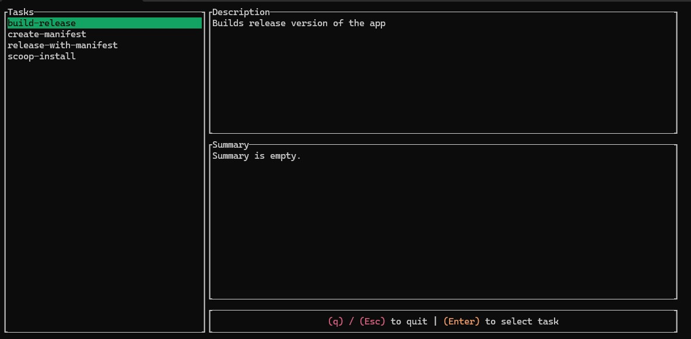

# Taskfile TUI

A high-performance, interactive terminal interface for managing and executing [Taskfile](https://taskfile.dev) tasks. Built with Rust and Ratatui, it provides a seamless way to navigate complex automation workflows without leaving the command line.

---

## 🚀 Key Engineering Features

### 1. Robust Terminal UI (Ratatui)
* **Stateful Lists:** Implements efficient state management for task navigation using `ratatui` and `crossterm`.
* **Dynamic Layouts:** Features a clear separation of concerns with a three-pane layout: Task List, Description viewer, and Command Summary.
* **Input Handling:** Non-blocking event polling ensures the UI remains responsive while waiting for user input.

### 2. YAML Engine & Data Integrity
* **BTreeMap Integration:** Utilizes `BTreeMap` for task storage, ensuring alphabetical sorting of tasks by default—a critical feature for large automation files.
* **Deep Parsing:** Extracts versioning, aliases, and nested metadata from `Taskfile.yml` using `serde_yaml` for strict type safety.

### 3. System Resilience & Safety
* **Panic Hooks:** Implements custom panic handlers (`panic::set_hook`). If the application crashes, it automatically restores the terminal state (disabling Raw Mode and leaving the Alternate Screen), preventing console corruption.
* **Cross-Platform Execution:** Smart shell detection (PowerShell for Windows, Sh for Unix) ensures reliable task execution across different operating systems.

### 4. Advanced Discovery Logic
* **Global & Local Scopes:** Supports both local directory discovery and global Taskfiles (via `--global`) located in the user's home directory.
* **Smart Filename Resolution:** Automatically resolves variations such as `Taskfile.yml` and `Taskfile.yaml`.

---

## 🛠 Tech Stack

* **Language:** Rust (Stable)
* **UI Framework:** Ratatui / Crossterm
* **Serialization:** Serde, Serde YAML
* **Error Management:** Anyhow (context-aware error reporting)
* **CLI:** Clap v4 (command-line argument parsing)

---

## 📂 Project Structure

* **`main.rs`**: Entry point. Orchestrates application initialization, terminal lifecycle management, and final post-shutdown task execution.
* **`app.rs`**: Core business logic. Manages keyboard events, item state persistence, and external command invocation logic.
* **`tui.rs`**: UI Rendering engine. Defines layouts, themes, and Ratatui widget composition.
* **`utils.rs`**: System utilities. Implements filesystem discovery, home directory resolution, and path buffering.
* **`errors.rs`**: Safety layer. Installs standard and panic hooks to guarantee terminal restoration on unexpected failures.
* **`Taskfile.yml`**: Self-referential automation config used for building, testing, and deploying the project itself.

---

## 📥 Installation

### From Source (Recommended)
Ensure you have the Rust toolchain installed. Clone the repository and build:
```bash
git clone [https://github.com/yourusername/taskfile_tui](https://github.com/yourusername/taskfile_tui)
cd taskfile_tui
cargo install --path .
```


